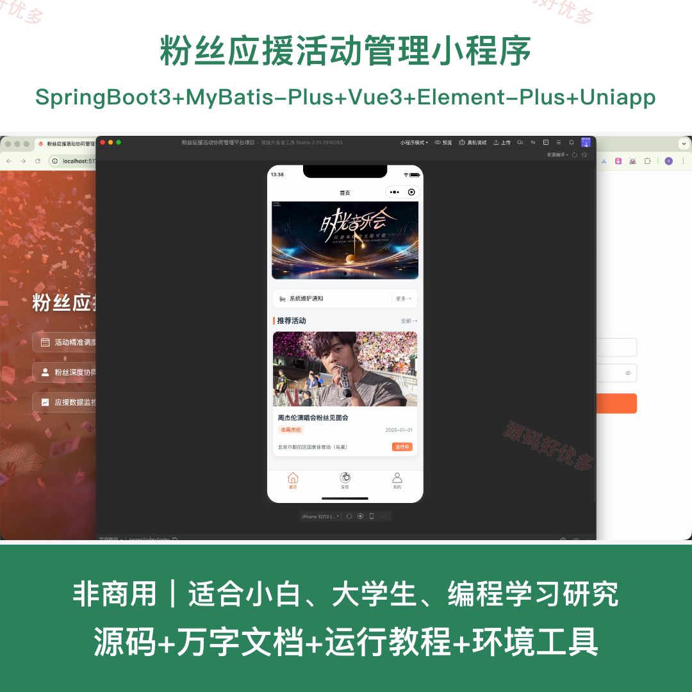
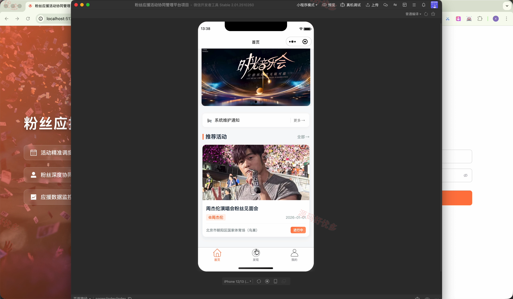
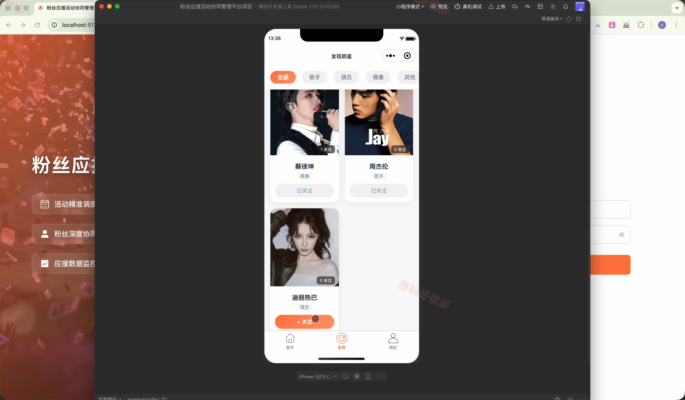
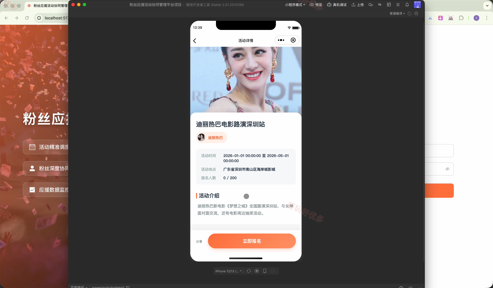
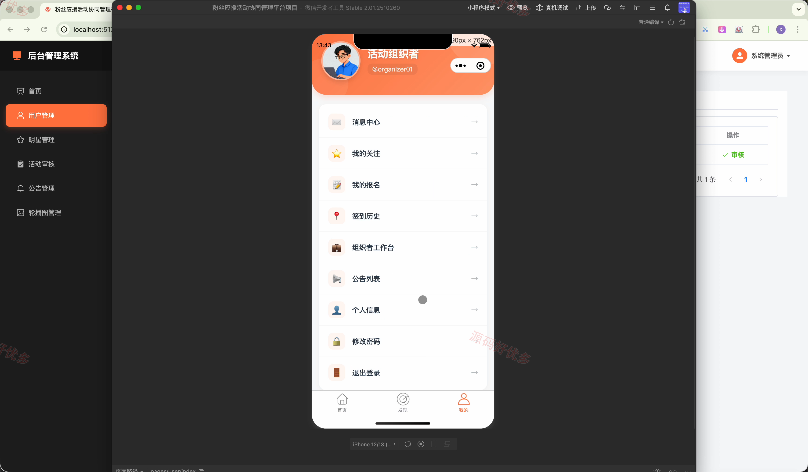
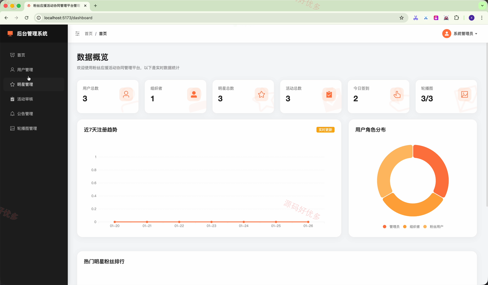
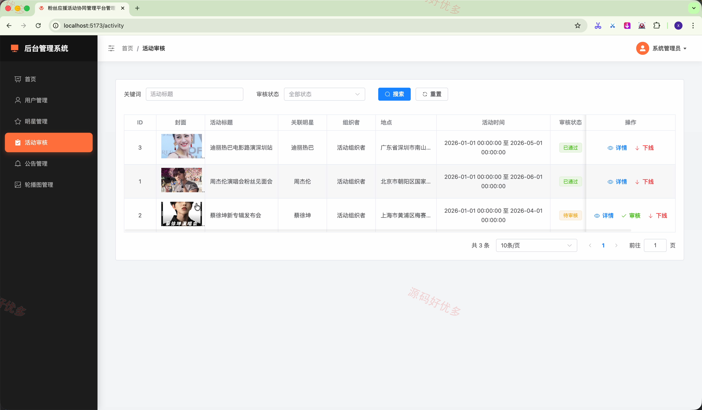
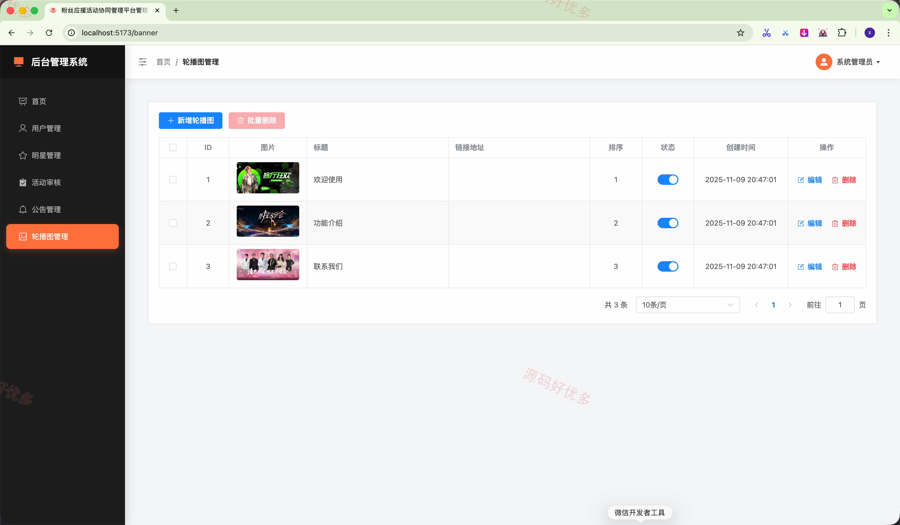
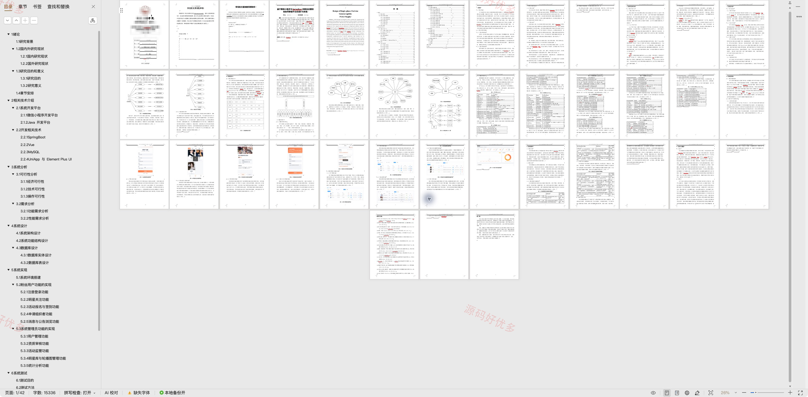

## 源码问题查看主页咨询

### 一、关键词
粉丝应援、明星活动、应援活动报名、粉丝见面会、活动签到

### 二、作品包含
源码+数据库+万字设计文档+全套环境和工具资源+本地部署教程

### 三、项目技术
前端技术： Html、Css、Js、Vue3.4、Element-Plus、uniapp
后端技术：Java、SpringBoot3.2.0、MyBatis-Plus

### 四、运行环境要求
开发工具：IDEA/eclipse + VSCODE + HBuilder X + 微信开发者工具

数据库：MySQL5.7（共10张表）

数据库管理工具：Navicat10以上版本

环境配置软件： JDK17 + Maven3.6

前端Nodejs：16+

浏览器：谷歌浏览器

### 五、项目介绍
项目编号：mpweixinA285D

本系统面向粉丝应援活动的发布、审核与参与。粉丝用户可浏览明星和活动、关注明星、报名活动、查看消息并签到；活动组织者可发布活动、管理报名签到和查看统计；管理员通过后台管理用户、明星、活动审核、公告和轮播图。

角色：管理员、用户、活动组织者

管理员功能：用户管理、明星管理、活动审核、公告管理、轮播图管理。

用户功能：浏览明星与活动、关注明星、活动报名与取消报名、活动签到、查看消息与公告、查看报名和签到记录、申请成为活动组织者。

活动组织者功能：发布与管理活动、报名签到管理、查看活动统计、发送活动提醒。

### 六、运行截图

